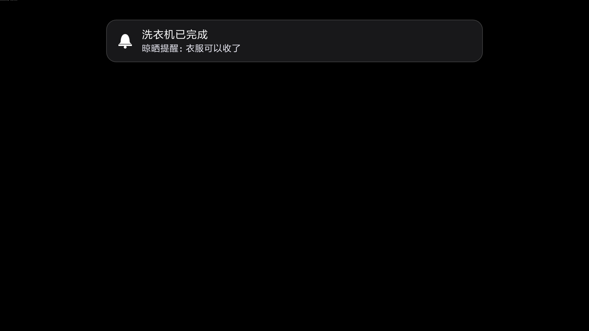
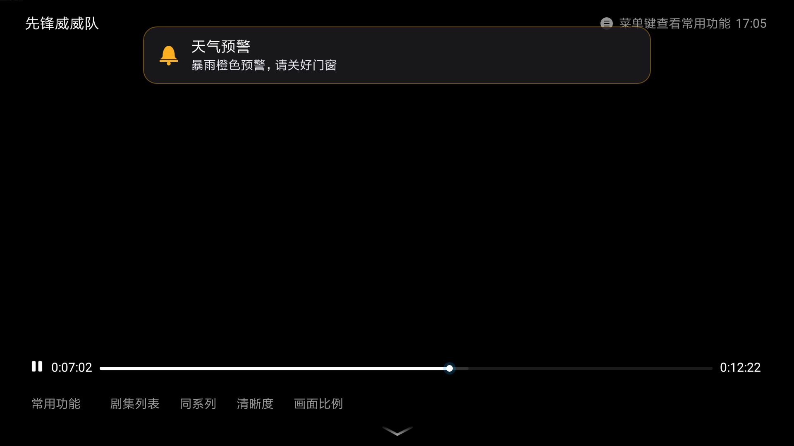
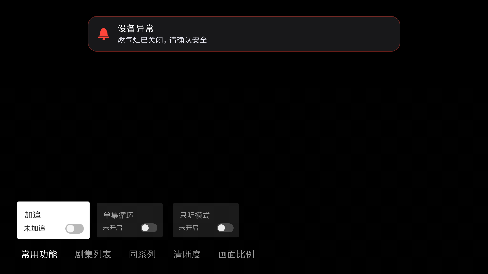

# TVNotify · 电视端局域网通知横幅

> 把小米电视（Android 6.0 / API 23）变成局域网通知屏：外部系统（Home Assistant、NAS、CI、树莓派……）发一个 HTTP POST，电视屏幕顶部就会飘出一条 tvOS 风格的横幅。

本项目是为「电视通知栏被裁掉、`cmd notification post` 在 API 23 上不可用」这类场景写的兜底方案：不做系统通知，直接 `WindowManager` 悬浮窗自绘。整个 App 只有两个依赖（NanoHTTPD + ZXing），不引入 AndroidX，APK 体积小到可以忽略。

---

## 🌟 Home Assistant 专属集成（推荐 · 自动发现）

强烈推荐配合专属 Home Assistant 自定义集成使用：

👉 **集成仓库**：[ha-yujian (GitHub)](https://github.com/JochenZhou/ha-yujian)

- **局域网 mDNS 自动发现**：TVNotify 电视端开机后自动广播 `_tvnotify._tcp`。安装 `ha-yujian` 后，Home Assistant「配置 → 设备与服务」将**自动发现**局域网内的这台电视，点击「配置」即可自动绑定，**无需手动查询与填写电视 IP 及 Token**！
- **原生通知实体与服务**：在 HA 自动化中通过 `notify.send_message` 或 `notify.tv_notify` 直接调用，支持标题、正文、分级着色（info / warn / error）、常驻与自定义提示音。
- **在线状态感知**：自动监控电视端 HTTP 与悬浮窗服务在线状态。

---

## 效果预览

真实电视截图（小米电视 1920×1080，Android 6.0）：

| `level: info` | `level: warn` | `level: error` |
| --- | --- | --- |
|  |  |  |

- 描边与铃铛随 `level` 变色：`info` 白 / `warn` 琥珀 `#FFB020` / `error` 红 `#FF453A`

```
┌──────────────────────────────────────────────────────────────┐
│                                                              │
│        ╭────────────────────────────────────────╮            │
│        │  🔔   洗衣机已完成                     │            │
│        │       晾晒提醒：衣服可以收了           │            │
│        ╰────────────────────────────────────────╯            │
│                                                              │
│                    （电视正在播放的内容）                    │
│                                                              │
└──────────────────────────────────────────────────────────────┘
```

- 深色半透明圆角卡片 + 1dp 描边，宽度固定为屏宽 64%，距顶 32dp
- 左侧矢量铃铛，右侧标题（18sp 白色粗体单行）+ 正文（15sp `#EBEBF5` 最多四行）
- 入场：上方滑入 + 淡入 250ms `DecelerateInterpolator`；退场：向上滑出 + 淡出
- 入场播放提示音（默认开，可按条静音）；`sticky` 常驻横幅由 `maxDuration` 兜底，也可 `POST /dismiss` 关闭
- 通知抢占：显示中再来一条，立刻替换并重新计时，绝不排队堆积

## 功能简介

| 能力 | 说明 |
| --- | --- |
| 常驻前台服务 | 固定端口 `8791`，`START_STICKY` 保活，开机自动拉起 |
| 局域网 HTTP 接口 | `POST /{token}/notify`，JSON 入参，token 鉴权 |
| 随机 token | 首次启动生成 8 位字母数字，持久化到 SharedPreferences，可一键重置 |
| 悬浮窗横幅 | `SYSTEM_ALERT_WINDOW` + 自绘，不抢遥控器焦点（`FLAG_NOT_FOCUSABLE`） |
| 分级着色 | `level` = `info` / `warn` / `error`，铃铛与描边变色，布局不变 |
| 常驻横幅 | `sticky: true` 不自动消失，靠 `maxDuration`（默认 300s）兜底，或 `POST /dismiss` 关闭 |
| 提示音 | 入场播放 `res/raw/chord.mp3`（走 `STREAM_MUSIC`），请求体 `sound: false` 可单条静音 |
| 健康探活 | `GET /health` 无需 token，返回版本、uptime、端口、横幅状态，供 HA availability 用 |
| mDNS 发现 | 广播 `_tvnotify._tcp`，TXT 带 token / 版本 / 路径 / 型号（**TV 端只负责广播**） |
| 设置界面 | 服务状态、悬浮窗权限、本机 IPv4、完整调用地址、二维码、测试/复制/重置 |
| 遥控器友好 | 三个按钮均有清晰的 D-Pad 焦点态，确认键直接触发 |

---

## 快速开始

### 1. 下载 APK

从仓库 [Releases](../../releases) 下载 `TVNotify-release.apk`，或者自己构建（见文末）。

### 2. 安装

```bash
adb connect 192.168.1.23:5555     # 电视需先开启「开发者选项 → USB 调试 / 网络调试」
adb install -r TVNotify-release.apk
```

### 3. 授予悬浮窗权限（必须）

横幅靠悬浮窗实现，没有这个权限什么都不会显示：

```bash
adb shell appops set com.zqc.tvnotify SYSTEM_ALERT_WINDOW allow
```

也可以打开 App 点「测试通知」，会直接跳到系统授权页。

### 4. 拉起服务（电视重启后一般不需要，开机广播会自动拉起）

```bash
adb shell am startservice -n com.zqc.tvnotify/.NotifyService
```

### 5. 拿到调用地址

打开 TVNotify，界面上会显示：

```
Token：k7m2p9x4
调用地址：http://192.168.1.23:8791/k7m2p9x4/notify
```

旁边的二维码扫一下即可导入到手机 / HA。

### 6. 发一条试试

```bash
curl -X POST http://192.168.1.23:8791/k7m2p9x4/notify \
  -H 'Content-Type: application/json' \
  -d '{"title":"洗衣机已完成","text":"晾晒提醒：衣服可以收了","duration":6}'
# 返回 {"ok":true}
```

---

## 接口文档

```
POST http://<电视IP>:8791/<token>/notify
Content-Type: application/json
```

### 请求参数

| 字段 | 类型 | 必填 | 默认 | 取值范围 | 说明 |
| --- | --- | --- | --- | --- | --- |
| `title` | string | 否 | `""` | — | 标题，单行，超出省略；空串则不显示标题行 |
| `text` | string | 否 | `""` | — | 正文，最多四行，超出省略；空串则不显示正文行 |
| `duration` | number | 否 | `5` | `1..30`（越界自动 clamp） | 横幅停留秒数；`sticky: true` 时被忽略 |
| `level` | string | 否 | `"info"` | `info` / `warn` / `error` | 分级着色；**未知值按 `info` 处理，不报错** |
| `sticky` | boolean | 否 | `false` | `true` / `false` | 常驻：不按 `duration` 自动消失，直到 `/dismiss` 或 `maxDuration` 到点 |
| `maxDuration` | number | 否 | `300` | `30..3600`（越界自动 clamp） | 仅 `sticky: true` 生效，单位秒；**强制兜底** |
| `sound` | boolean | 否 | `true` | `true` / `false` | 本条是否播放提示音 |
| `image` | string | 否 | `null` | HTTP/HTTPS URL | 静态图片/抓拍快照 URL，右侧 16:9 画卷展示 |
| `image_base64` | string | 否 | `null` | Base64 编码 | 图片 Base64（支持 `data:image/...;base64,` 前缀） |
| `video` | string | 否 | `null` | HTTP/HTTPS URL | 动态视频流 URL（**MJPEG 流**，纯软解不占硬件解码器） |

`title` 与 `text` 去首尾空白后**同时为空**会被拒绝。

`level` 对应的视觉效果（只改颜色，不改布局）：

| `level` | 铃铛图标 | 卡片描边 |
| --- | --- | --- |
| `info`（默认） | 白色 | `#33FFFFFF` |
| `warn` | 琥珀 `#FFB020` | `#66FFB020` |
| `error` | 红 `#FF453A` | `#66FF453A` |

> 为什么 `sticky` 还要有 `maxDuration`：横幅窗口是 `FLAG_NOT_TOUCHABLE` + `FLAG_NOT_FOCUSABLE`，
> 遥控器点不到也关不掉。如果推送方崩溃、没人再调 `/dismiss`，没有兜底的横幅会永久占屏，
> 用户只能重启电视。所以 `maxDuration` 是安全阀，不是可选项。

### 响应

| HTTP 状态 | 场景 | Body |
| --- | --- | --- |
| `200` | 校验通过 | `{"ok":true}` |
| `400` | 内容为空 | `{"ok":false,"error":"empty content"}` |
| `400` | 请求体不是合法 JSON | `{"ok":false,"error":"invalid json"}` |
| `404` | token 不匹配或路径非法 | `{"ok":false,"error":"not found"}` |
| `405` | 方法不是 POST | `{"ok":false,"error":"method not allowed"}` |

所有响应均为 `Content-Type: application/json; charset=utf-8`。

> 设计说明：token 错误刻意返回 `404` 而不是 `403`，让扫描器无法区分「地址不存在」和「token 不对」。

### cURL 示例

```bash
# 最简
curl -X POST "http://192.168.1.23:8791/k7m2p9x4/notify" \
  -H 'Content-Type: application/json' \
  -d '{"title":"门铃","text":"有人按门铃"}'

# 指定停留 15 秒
curl -X POST "http://192.168.1.23:8791/k7m2p9x4/notify" \
  -H 'Content-Type: application/json' \
  -d '{"title":"下载完成","text":"Ubuntu 24.04 ISO 已就绪","duration":15}'

# 天气预警：红色 + 常驻 10 分钟 + 响提示音
curl -X POST "http://192.168.1.23:8791/k7m2p9x4/notify" \
  -H 'Content-Type: application/json' \
  -d '{"title":"暴雨红色预警","text":"预计未来 3 小时降水量将达 100 毫米以上，请避免外出并注意地下车库进水。","level":"error","sticky":true,"maxDuration":600}'

# 半夜的备份完成通知：不响
curl -X POST "http://192.168.1.23:8791/k7m2p9x4/notify" \
  -H 'Content-Type: application/json' \
  -d '{"title":"备份完成","text":"NAS 快照已上传","sound":false}'

# 门铃抓拍（静态快照图片 URL）
curl -X POST "http://192.168.1.23:8791/k7m2p9x4/notify" \
  -H 'Content-Type: application/json' \
  -d '{"title":"门口访客","text":"检测到有人按响门铃","image":"http://192.168.1.100:8123/api/camera_proxy/camera.doorbell","duration":10}'

# 摄像头实时视频流（动态 MJPEG 流，右侧 16:9 实时刷新画卷）
curl -X POST "http://192.168.1.23:8791/k7m2p9x4/notify" \
  -H 'Content-Type: application/json' \
  -d '{"title":"实时灵镜","text":"正在调取庭院实时监控画面","video":"http://192.168.1.100:8123/api/camera_proxy_stream/camera.backyard","duration":15}'
```

---

## 接口：POST /{token}/dismiss

关闭当前正在显示的横幅（无论它是否 `sticky`）。**幂等**：没有横幅时也返回 `200`。

```bash
curl -X POST "http://192.168.1.23:8791/k7m2p9x4/dismiss"
```

```json
{"ok":true,"dismissed":true}
```

| HTTP 状态 | 场景 | Body |
| --- | --- | --- |
| `200` | 当前有横幅，已开始退场 | `{"ok":true,"dismissed":true}` |
| `200` | 当前没有横幅 | `{"ok":true,"dismissed":false}` |
| `404` | token 不匹配或路径非法 | `{"ok":false,"error":"not found"}` |
| `405` | 方法不是 POST | `{"ok":false,"error":"method not allowed"}` |

> 幂等是刻意设计：HA 自动化可能重试、或者横幅已被 `maxDuration` 自动收走，
> 这两种情况都返回 `200`，调用方不必为此写重试/容错分支。

---

## 接口：GET /health

健康探活，**不需要 token**（Home Assistant 的 availability 探针要在拿到地址前就能用）。

```bash
curl "http://192.168.1.23:8791/health"
```

```json
{"ok":true,"version":"1.1.0","uptime":3621,"port":8791,"banner":"showing"}
```

| 字段 | 类型 | 说明 |
| --- | --- | --- |
| `ok` | boolean | 恒为 `true`（能返回就说明服务活着） |
| `version` | string | App 版本，当前 `1.1.0` |
| `uptime` | number | 服务启动至今的秒数（`SystemClock.elapsedRealtime` 计算，不受系统对时跳变影响） |
| `port` | number | 监听端口，固定 `8791` |
| `banner` | string | `showing` 表示横幅正在显示，`idle` 表示没有横幅 |

非 `GET` 返回 `405`；路径不匹配（含多段路径）仍走原有 `404` 兜底。

HA 里可以这样用：

```yaml
binary_sensor:
  - platform: rest
    name: TVNotify 在线
    resource: "http://192.168.1.23:8791/health"
    value_template: "{{ value_json.ok }}"
    scan_interval: 60
```

---

## 提示音

- 横幅**入场时播放** `app/src/main/res/raw/chord.mp3`，默认开启。
- 走 `AudioManager.STREAM_MUSIC` 通道：电视上 `STREAM_NOTIFICATION` 经常被系统静音，用媒体通道才能真的响。
- 单条静音：请求体加 `"sound": false`。想全部静音就在推送模板里固定加上这个字段（本项目不读系统音量、也不申请 `MODIFY_AUDIO_SETTINGS`）。
- 提示音实例全程只创建一次，播完自动停；抢占替换时先把播放位置归零再播，不会叠出两路声音。
- 音频设备被其他前台 App 独占时只记日志，不会崩、也不影响横幅显示。

---

## mDNS 发现

> ⚠️ **TV 端只负责广播，不做消费。** Home Assistant 侧必须有集成消费 zeroconf / mDNS 事件（例如
> `zeroconf` 集成、或某个自定义集成监听 `_tvnotify._tcp` 的 `zeroconf_service_added` 事件）
> 才能真正「自动发现」这台电视。只装本 App、不配 HA 的发现逻辑，什么都不会自动出现。

| 项目 | 值 |
| --- | --- |
| 服务类型 | `_tvnotify._tcp`（完整：`_tvnotify._tcp.local`） |
| 端口 | `8791` |
| 实例名 | `TVNotify-<token 后 4 位>`，例：`TVNotify-p9x4` |
| TXT `version` | `1.1.0` |
| TXT `path` | `/notify`（完整的调用路径是 `/{token}/notify`） |
| TXT `token` | 完整 token，便于 HA 自动拼出调用地址 |
| TXT `model` | `Build.MODEL`，多台电视时人眼区分用 |

```bash
# 在局域网内验证广播是否存在（需要 avahi-utils）
avahi-browse -rt _tvnotify._tcp
```

关于 token 明文广播的取舍：HA 要靠 TXT 里的 `token` 自动填配置，否则「发现」之后还要用户手抄一次，
发现就没有意义了。这与 App 界面直接把带 token 的完整地址做成二维码属于同一层信任模型——
**前提是局域网可信**。如果你的网络里有不可信设备，请不要依赖自动发现，改用固定的地址+token。

Android 6.0 相关：组播需要 `MulticastLock` + `CHANGE_WIFI_MULTICAST_STATE` 权限，Manifest 里已声明，
**不要因为「看起来冗余」而删掉**。广播端口被占用、或者没有可用网络时只记日志（`TVNotifyMdns` tag），
HTTP 服务照常工作。

---

## Home Assistant 接入

推荐用官方集成 **[玉简 for Home Assistant](https://github.com/JochenZhou/ha-yujian)**（HACS 可装）：电视端广播 `_tvnotify._tcp.local.`，TXT 里带 token，HA 起来后**自动发现电视、自动建好配置项**，不需要手抄地址或扫码。

[](https://my.home-assistant.io/redirect/hacs_repository/?owner=JochenZhou&repository=ha-yujian&category=integration)
[](https://my.home-assistant.io/redirect/config_flow_start/?domain=tvnotify)

**一键安装**：点上面第一个徽章 → 浏览器跳到你的 HA 实例 → 确认仓库地址 → **ADD** → HACS 里搜索 **玉简** → 下载 → **重启 HA**。

点第二个徽章可直接跳到「添加集成」配置页。

装好后电视会成为一个通知实体（形如 `notify.tvnotify_tyeq`），自动化里这样用：

```yaml
automation:
  - alias: "洗衣机完成 → 电视横幅"
    trigger:
      - platform: state
        entity_id: sensor.washer_status
        to: "finished"
    action:
      - action: notify.send_message
        target:
          entity_id: notify.tvnotify_tyeq
        data:
          title: 洗衣机已完成
          message: 晾晒提醒：衣服可以收了
```

集成还带一个便捷服务 `yujian.notify`，可以带附加参数（`duration` / `level` / `sticky` / `sound`），这些参数在自动化编辑器里是下拉框、滑块和开关，可直接点选。集成在电视端服务被系统杀掉时**自动经 ADB 拉起并重试**。细节见[集成仓库 README](https://github.com/JochenZhou/ha-yujian)。

### 不用集成时：直接用 HTTP

任何能发 HTTP POST 的系统都能推：

```bash
curl -X POST "http://192.168.1.23:8791/k7m2p9x4/notify" \
  -H 'Content-Type: application/json' \
  -d '{"title":"洗衣机已完成","text":"晾晒提醒：衣服可以收了","duration":6}'
```

### 只用 HA 内置能力（`notify.rest` 平台）

不装集成、也不写代码时，可以让 HA 用内置的 `notify.rest` 平台直接 POST：

```yaml
notify:
  - name: tv_notify
    platform: rest
    resource: "http://192.168.1.23:8791/k7m2p9x4/notify"
    method: POST_JSON
    title_param_name: title
    message_param_name: text
    data:
      duration: 6
    verify_ssl: false
```

> `data:` 里的键会原样拼进 JSON body，所以 `duration` 直接生效。

### 关键点：先确保服务活着

电视的省电策略可能已经把服务干掉，直接发大概率超时。集成已经处理了这一点；用 `notify.rest` 时需要在自动化里先通过 `androidtv.adb_command` 拉起服务，**delay 1 秒**等服务绑定端口，再发通知：

```yaml
automation:
  - alias: "洗衣机完成 → 电视横幅"
    trigger:
      - platform: state
        entity_id: sensor.washer_status
        to: "finished"
    action:
      # 1. 先确保服务活着（幂等，重复调用安全）
      - action: androidtv.adb_command
        target:
          entity_id: media_player.living_room_tv
        data:
          command: "am startservice -n com.zqc.tvnotify/.NotifyService"
      # 2. 等服务绑定 8791 端口
      - delay: "00:00:01"
      # 3. 再推送横幅
      - action: notify.tv_notify
        data:
          title: 洗衣机已完成
          message: 晾晒提醒：衣服可以收了
```

前提：HA 已配置 [Android TV 集成](https://www.home-assistant.io/integrations/androidtv/)（需要 ADB 连接），并且电视的 ADB 授权没有被清掉。

### Shell 版（不用 Android TV 集成时）

```yaml
shell_command:
  tv_wake_notify: >-
    adb -s 192.168.1.23:5555 shell am startservice -n com.zqc.tvnotify/.NotifyService &&
    sleep 1 &&
    curl -s -X POST "http://192.168.1.23:8791/k7m2p9x4/notify"
    -H 'Content-Type: application/json'
    -d '{"title":"{{ title }}","text":"{{ message }}"}'
```

---

## 自建 / 二次开发

### 环境

- JDK 17
- Gradle 8.7（AGP 8.5.2）
- Android SDK Platform 34（`compileSdk 34`，`minSdk 23`，`targetSdk 34`）

### 构建

```bash
cp local.properties.example local.properties   # 改成自己的 sdk.dir
gradle assembleRelease
# 产物：app/build/outputs/apk/release/app-release.apk
```

仓库**不含** `gradle/wrapper/gradle-wrapper.jar`（二进制不入库），因此请用本机 `gradle` 命令或 CI 里的 `gradle/actions/setup-gradle`，不要用 `./gradlew`。

### 签名三级降级

`app/build.gradle.kts` 按以下顺序找签名材料，全都没有时 Release 直接回退 debug 签名，保证**零配置也能出包**：

1. 环境变量：`KEYSTORE_FILE` / `KEYSTORE_PASSWORD` / `KEY_ALIAS` / `KEY_PASSWORD`
2. 本地文件：`local/release.keystore` + `local/keystore.properties`
3. 回退：`signingConfigs.getByName("debug")`

`local/keystore.properties` 格式：

```properties
storeFile=local/release.keystore
storePassword=你的密码
keyAlias=tvnotify
keyPassword=你的密码
```

### 关于 R8

Release 打开了 `isMinifyEnabled` + `isShrinkResources`。`proguard-rules.pro` 中已 keep `fi.iki.elonen.**`（含 `$*` 内部类）和 `com.google.zxing.**`，**不要删**——NanoHTTPD 的内部类与 ZXing 的枚举一旦被混淆/裁剪，运行时会直接 `NoClassDefFoundError`。

---

## FAQ

### 横幅不出现？

按顺序排查：

1. **悬浮窗权限**：`adb shell appops get com.zqc.tvnotify SYSTEM_ALERT_WINDOW`，必须是 `allow`。国产 ROM 有时需要手动在设置里点一遍。
2. **服务是否在跑**：`adb shell dumpsys activity services com.zqc.tvnotify | grep NotifyService`
3. **端口是否监听**：`adb shell netstat -an | grep 8791`（或 `curl -v` 直接看是否 connection refused）
4. **接口返回什么**：`curl -i`，看是 404（token 错）、405（方法错）还是 400（内容空）。

### 粘性横幅怎么关掉？

`sticky: true` 的横幅不按 `duration` 自动消失，两种关闭方式：

1. **主动关**：`curl -X POST "http://<电视IP>:8791/<token>/dismiss"`（幂等，重复调用不会报错）；
2. **等兜底**：`maxDuration` 到点（默认 `300` 秒，可设 `30..3600`）自动淡出。

横幅窗口是 `NOT_TOUCHABLE` / `NOT_FOCUSABLE`，遥控器点不到它——这是刻意设计，避免抢走播放中 App 的焦点，
所以关闭只能走接口或等超时。**不要**把 `maxDuration` 设得过大，否则推送方崩溃时电视会被一直占屏。

### 后台被杀 / 一段时间后就没反应？

Android 6.0 电视 + 小米省电策略是主因，前台服务只是提升优先级，不保证不被杀。处理方式：

1. 在 Home Assistant 自动化里保留 `am startservice` 那一步（本项目的服务是幂等的，重复拉起无副作用）；
2. 需要更硬的保活可以接一个定时 ping 的自动化（每 30 分钟发一条空通知会打扰用户，建议只在需要时拉起）。

### ADB 强制拉起服务

```bash
adb shell am startservice -n com.zqc.tvnotify/.NotifyService
# 若返回 "Not allowed to start service Intent"，说明是系统后台限制：
adb shell am start-foreground-service -n com.zqc.tvnotify/.NotifyService
# 查看服务日志
adb logcat -s TVNotifyService TVNotifyHttp TVNotifyBanner
```

### 忘了 / 想换 Token

打开 App 点「重置 Token」。服务端每个请求都会重新读 SharedPreferences，**无需重启服务**，旧地址立即返回 404。重置后记得同步改 HA 的 `resource`。

### 电视 IP 变了怎么办

在路由器上给电视的 MAC 做静态 DHCP 绑定，否则每次重启都要改 HA 配置和二维码。

### 怎么配置自己的签名 Secrets（GitHub Actions）

到 `Settings → Secrets and variables → Actions` 添加：

| Secret | 内容 |
| --- | --- |
| `KEYSTORE_BASE64` | `base64 -w0 local/release.keystore` 的输出 |
| `KEYSTORE_PASSWORD` | keystore 密码 |
| `KEY_ALIAS` | key 别名 |
| `KEY_PASSWORD` | key 密码 |

四个都配了才会走正式签名；配不全就自动回退 debug 签名，CI 不会中断。

```bash
# 生成 keystore
keytool -genkeypair -v -keystore local/release.keystore \
  -alias tvnotify -keyalg RSA -keysize 2048 -validity 10000
# 转 base64
base64 -w0 local/release.keystore     # macOS: base64 -i local/release.keystore
```

### 为什么不能用系统通知？

- 电视（尤其 Aerial 桌面）根本没有通知栏，遥控器无法下拉；
- `adb shell cmd notification post` 在 Android 6.0 上不存在；
- 即便弹出，系统通知样式也无法做成 tvOS 那种居中卡片。

---

## 目录结构

```
TVNotify/
├── .github/workflows/build.yml        # CI：Gradle 8.7 + assembleRelease + Release 挂载
├── app/
│   ├── build.gradle.kts               # 签名三级降级、R8、minSdk 23
│   ├── proguard-rules.pro             # keep NanoHTTPD / ZXing
│   └── src/main/
│       ├── AndroidManifest.xml
│       ├── java/com/zqc/tvnotify/
│       │   ├── MainActivity.kt        # 设置界面（D-Pad 焦点、二维码）
│       │   ├── NotifyService.kt       # 前台服务、HTTP 与 mDNS 生命周期
│       │   ├── NotifyHttpServer.kt    # NanoHTTPD 路由：notify / dismiss / health
│       │   ├── BannerController.kt    # 悬浮窗横幅、分级着色、动画、提示音
│       │   ├── MdnsAdvertiser.kt      # 手写 DNS-SD 广播（_tvnotify._tcp）
│       │   ├── BootReceiver.kt        # 开机自启
│       │   ├── Prefs.kt               # token 持久化
│       │   └── NetUtils.kt            # 本机 IPv4 探测
│       └── res/
│           ├── drawable/ic_launcher.xml
│           ├── drawable/ic_stat_notify.xml
│           ├── raw/chord.mp3          # 横幅入场提示音
│           └── values/{strings,styles}.xml
├── settings.gradle.kts
├── build.gradle.kts
├── gradle.properties
├── local.properties.example
└── .gitignore
```

## 许可

MIT
